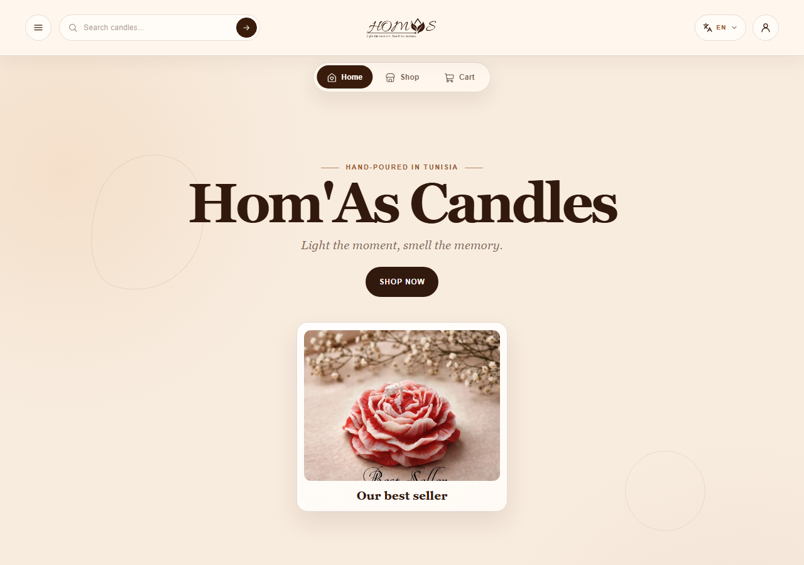
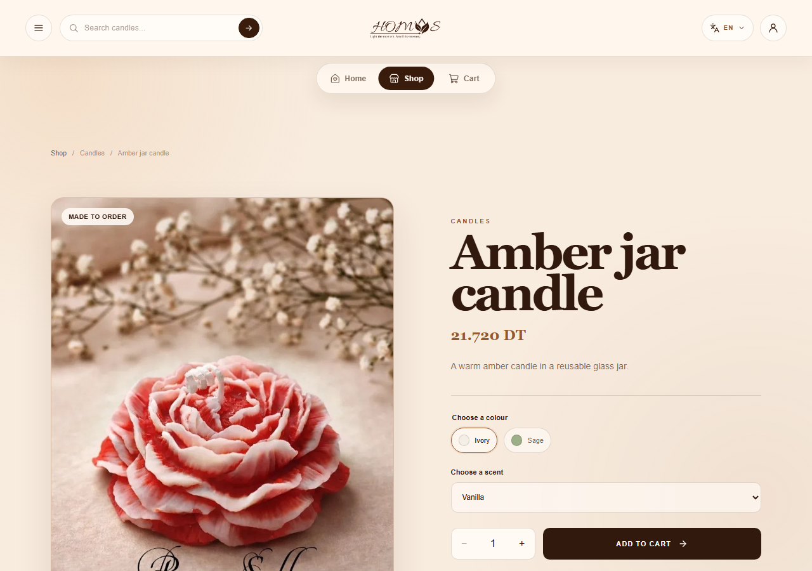
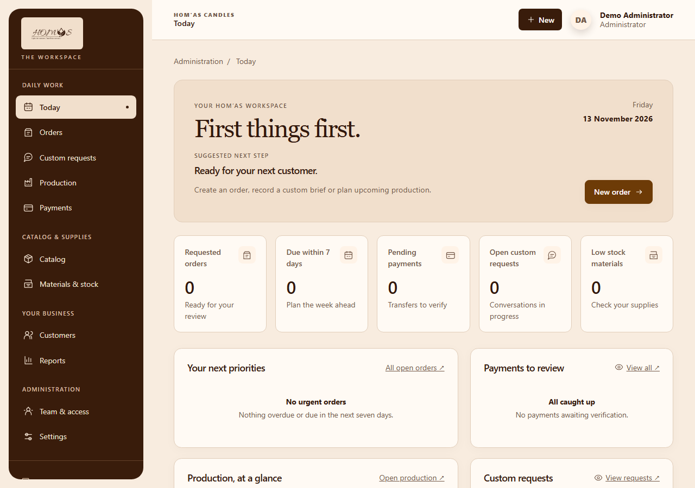
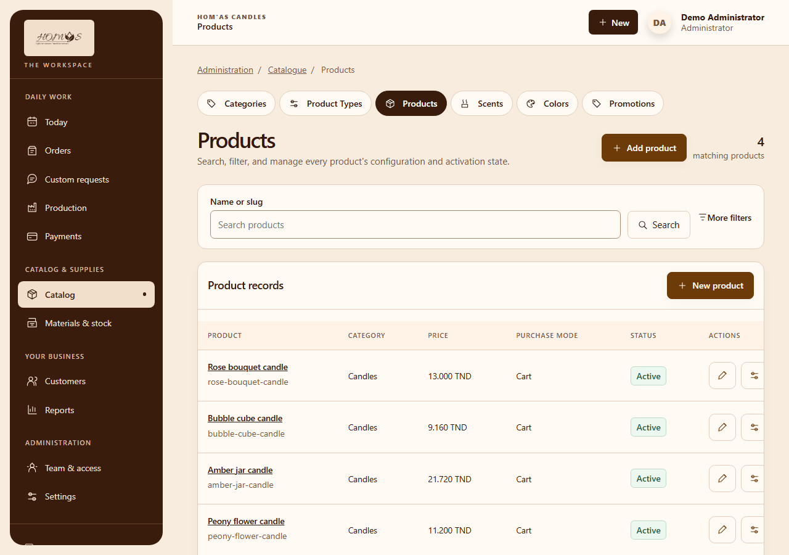

# Hom'As Candles

[](https://github.com/Mariemx4/homas-candles/actions/workflows/tests.yml)

A trilingual (English, French, Arabic) online shop and back-office for a
Tunisian maker of handmade scented candles. Customers browse, customise and
order candles; the workshop runs orders, payments, production, stock and
custom requests from one admin workspace.

Plain PHP 8.3 and PostgreSQL 17 — no framework — with a layered architecture,
58 automated test suites and a one-command local demo.

| Storefront | Product page | Mobile |
| --- | --- | --- |
|  |  |  |

| Admin: today's work | Admin: catalogue |
| --- | --- |
|  |  |

## Try it locally

You need Docker. From the project folder:

```bash
docker compose up --build
```

Then open <http://localhost:8080>. The first start builds the image, applies
all migrations to a separate demo database and loads four demo candles.

- Admin workspace: <http://localhost:8080/admin/login.php>, sign in with
  `admin@demo.test` / `DemoAdmin-2026!` (demo-only account).
- Remove everything, including the demo database: `docker compose down -v`.

The demo never touches a real shop: its seed script refuses to run unless it
is connected to the `homas_demo` database.
  
## What it does

**Storefront**
- Catalogue in three languages, right-to-left layout for Arabic, search and filters.
- Product options (colour, scent), quantity pricing, cart and checkout with
  delivery or pickup, minimum order and deposit rules.
- Customer accounts with saved addresses, order tracking, self-service order
  edits and cancellation before production, Google sign-in.
- Payment by cash on delivery or D17 transfer with uploaded proof.

**Admin workspace**
- "Today" dashboard of what needs attention.
- Orders through their full life cycle (requested → confirmed → preparing →
  prepared → delivered/picked up), staff-entered orders, edits and a trash.
- Custom requests from enquiry to quotation to order.
- Catalogue with an activation checklist, translation drafts, photos per colour.
- Materials, recipes and stock: preparing an order deducts its materials and
  accessories exactly once.
- Payment review, production planning, customers and reports.

## Engineering highlights

- **Layered design.** `public/` entry points → `app/Bootstrap` wiring →
  controllers → services (business rules) → repositories (all SQL). See
  [docs/architecture.md](docs/architecture.md).
- **Pricing from costs.** Selling prices are calculated from material recipes
  by one service, in integer thousandths of a dinar to avoid rounding errors;
  orders keep frozen price snapshots.
- **Data integrity in the database too.** Constraints and triggers protect
  order snapshots and recipes; checksummed migrations refuse edited history.
- **Security.** Argon2id passwords, CSRF tokens on every form, rate-limited
  sign-in, separate customer and admin sessions, private payment evidence
  outside the web root.
- **Tests that cannot hurt real data.** Every integration suite runs in a
  throwaway PostgreSQL schema or database, enforced by
  `scripts/check-project.php`. A read-only live check compares the production
  schema with the migrations.

## Tests

CI runs the structural checks and all PHP suites on every push
([workflow](.github/workflows/tests.yml)). Locally, with the demo running:

```bash
docker compose exec app php scripts/check-project.php
```

The suites need a PostgreSQL role that may create databases; see
[tests/README.md](tests/README.md) for how to run them and what each covers.

## Project structure

```text
public/        HTTP entry points (stable URLs) and browser assets
app/Bootstrap/ Dependency wiring for each area
app/Views/     Layouts, components and page templates
app/config/    Configuration (private *.local.php files are not committed)
app/database/  Checksummed migrations and reference data
src/           Controllers, Services, Repositories, Auth, Http, View
scripts/       Migrations, backups, preflight, structural checks
tests/         Unit, integration, live and browser checks
docker/demo/   Start-up and demo data for docker compose
docs/          Architecture, handbook, operations and history
```

New to the code? Start with the [beginner handbook](docs/beginner-handbook.md),
then the [architecture map](docs/architecture.md) and
[routing reference](docs/routing.md). Running the real shop (deployment,
search indexing, sign-in limits, email, administrator access) is covered in
[docs/operations.md](docs/operations.md).

## License

© 2026 Hom'As Candles. All rights reserved. The source is published for
review and portfolio purposes; the brand, photographs and texts may not be
reused.
